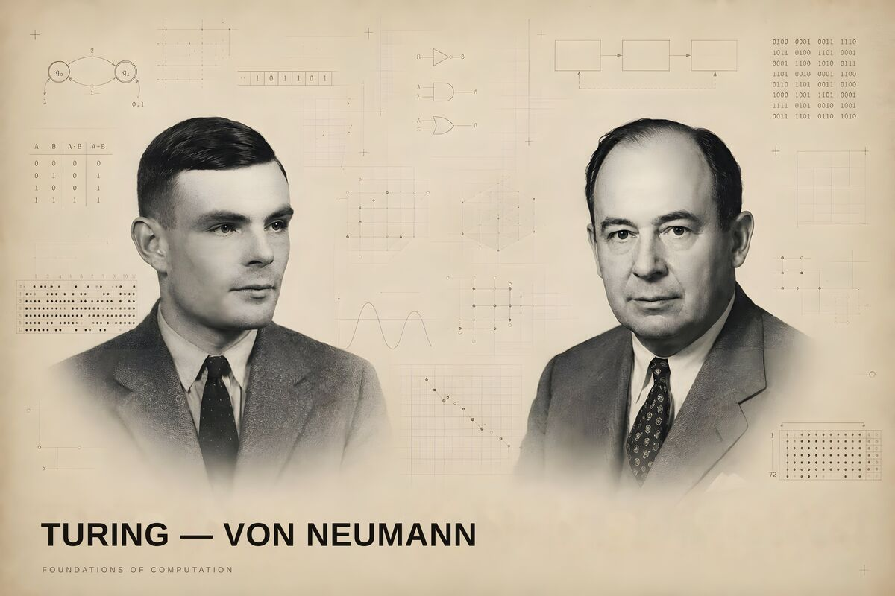
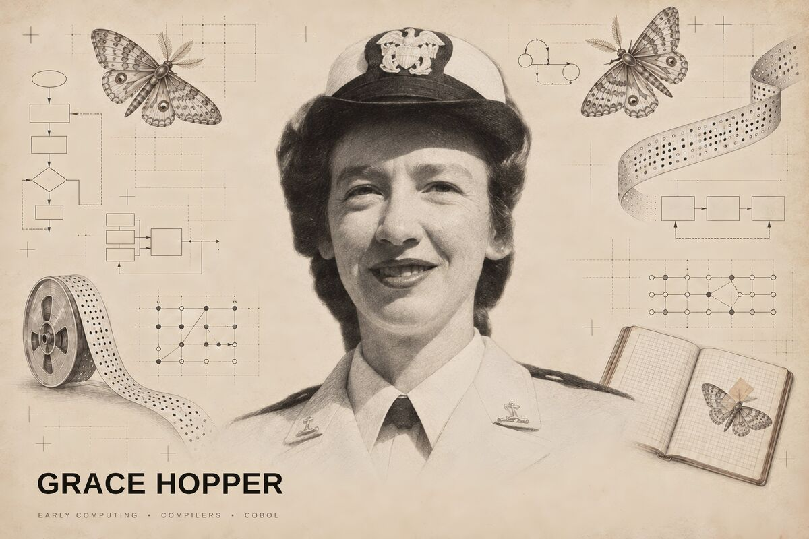
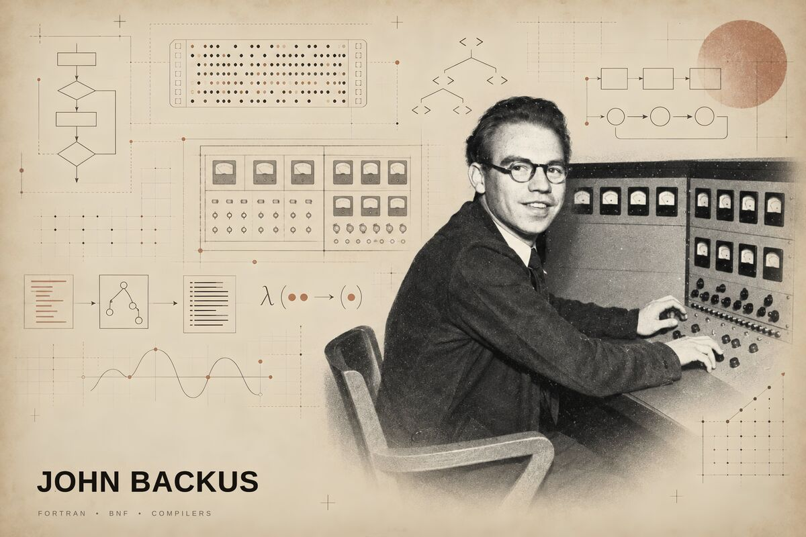
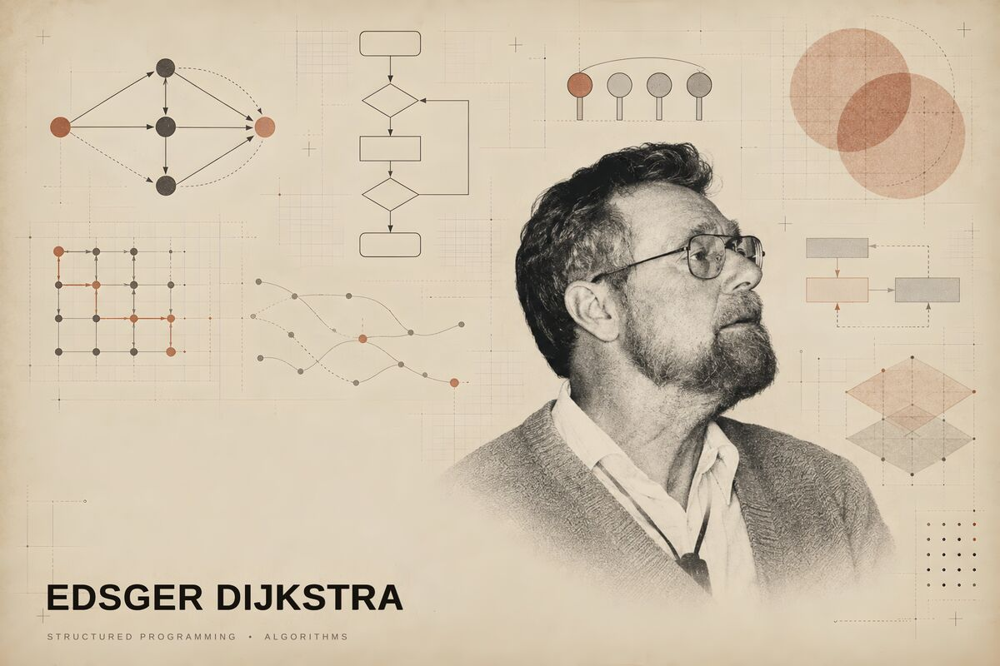
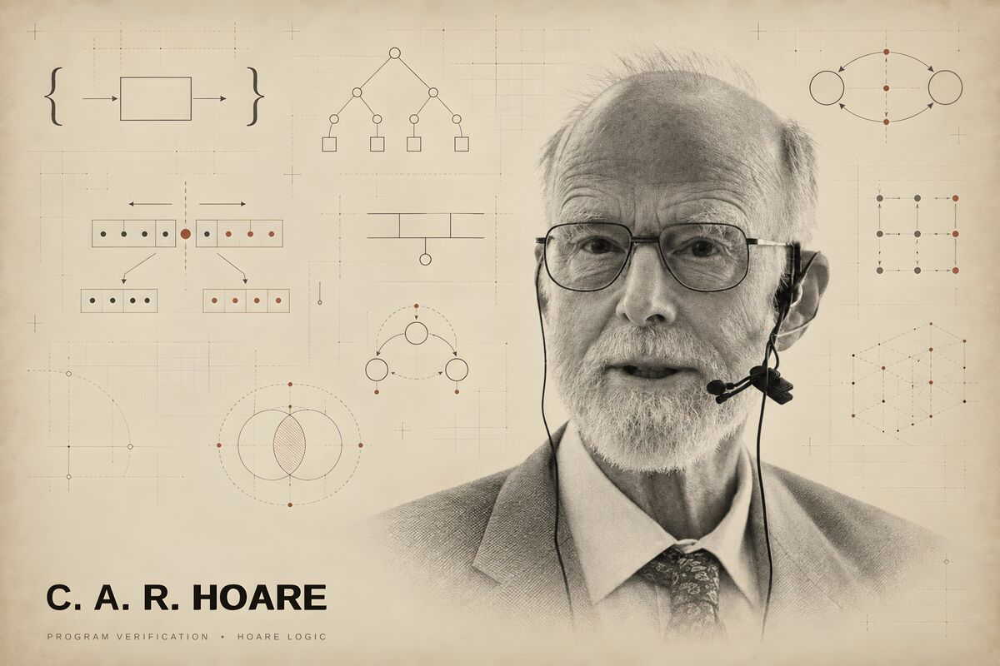
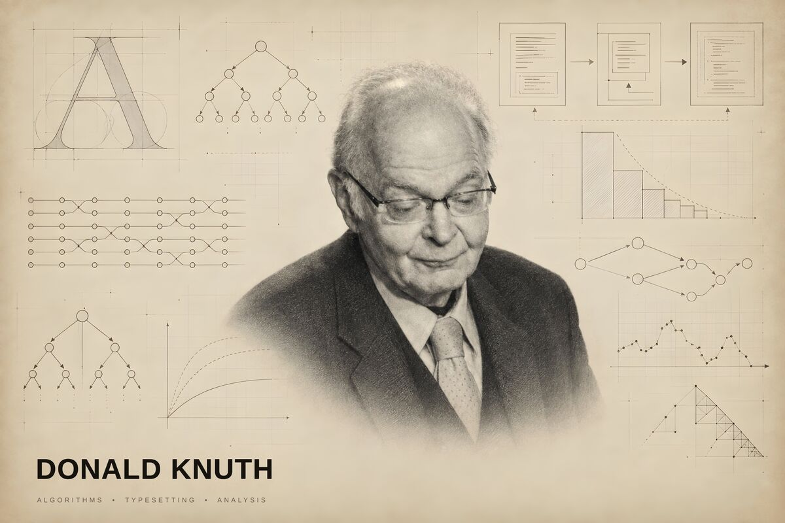
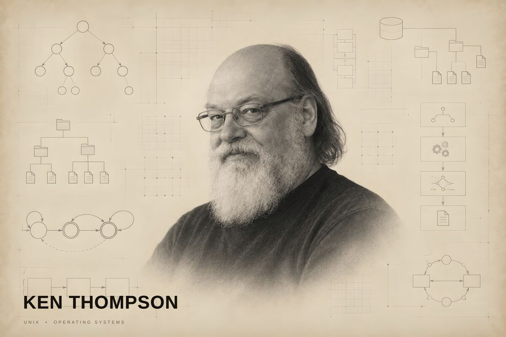
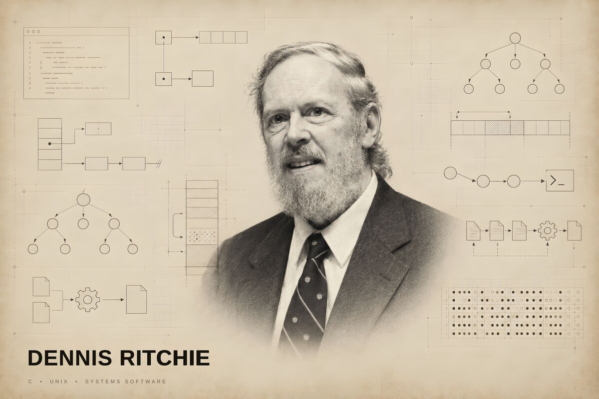
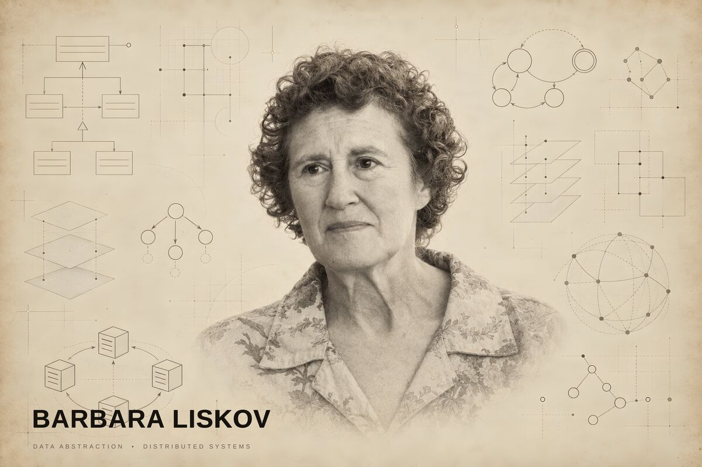
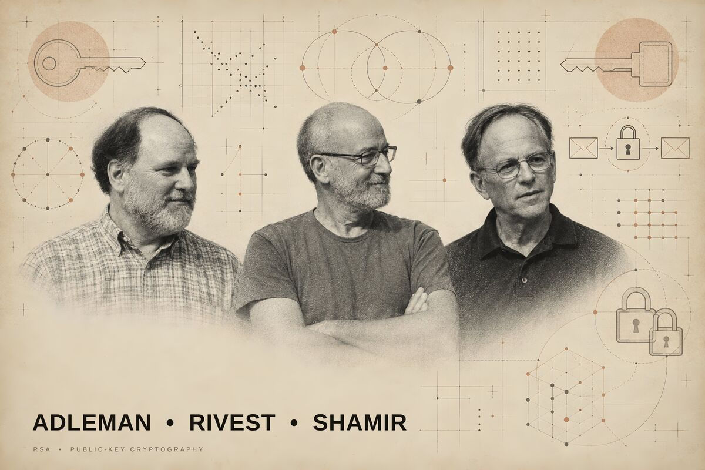

# Omarchy Giants Theme

Standing on the shoulders of giants. A warm, low-contrast dark theme for
[Omarchy](https://omarchy.org) built around ink on aged paper: sepia and cream
foregrounds over a soft brown-black background, with a dusty terracotta accent.

This is for the original creators who made foundational contributions to computer science.
(We'll do another series for Internet and later).


## Wallpapers

Ten portraits of the giants everything since was built on, drawn as ink on
aged paper with technical diagrams of their contributions. Click any one for the
full 6144×4096 wallpaper.

<table>
<tr><td width="50%" align="center"><a href="backgrounds/1-turing-von-neumann.jpg"></a><br><strong>Alan Turing and John von Neumann</strong><br><sub>computability and the stored-program computer</sub></td><td width="50%" align="center"><a href="backgrounds/2-grace-hopper.jpg"></a><br><strong>Grace Hopper</strong><br><sub>compilers and COBOL</sub></td></tr>
<tr><td width="50%" align="center"><a href="backgrounds/3-john-backus.jpg"></a><br><strong>John Backus</strong><br><sub>FORTRAN, BNF, and compilers</sub></td><td width="50%" align="center"><a href="backgrounds/4-edsger-dijkstra.jpg"></a><br><strong>Edsger Dijkstra</strong><br><sub>structured programming and algorithms</sub></td></tr>
<tr><td width="50%" align="center"><a href="backgrounds/5-tony-hoare.jpg"></a><br><strong>C. A. R. Hoare</strong><br><sub>program verification and Hoare logic</sub></td><td width="50%" align="center"><a href="backgrounds/6-donald-knuth.jpg"></a><br><strong>Donald Knuth</strong><br><sub>algorithms, TeX, and technical publishing</sub></td></tr>
<tr><td width="50%" align="center"><a href="backgrounds/7-ken-thompson.jpg"></a><br><strong>Ken Thompson</strong><br><sub>Unix and operating systems</sub></td><td width="50%" align="center"><a href="backgrounds/8-dennis-ritchie.jpg"></a><br><strong>Dennis Ritchie</strong><br><sub>C and Unix</sub></td></tr>
<tr><td width="50%" align="center"><a href="backgrounds/9-barbara-liskov.jpg"></a><br><strong>Barbara Liskov</strong><br><sub>data abstraction and distributed systems</sub></td><td width="50%" align="center"><a href="backgrounds/10-adleman-rivest-shamir.jpg"></a><br><strong>Adleman · Rivest · Shamir</strong><br><sub>RSA public-key cryptography</sub></td></tr>
</table>

Research notes, source portrait credits, licenses, and generation details are in
[CREDITS.md](CREDITS.md).

## Install

```bash
omarchy theme install https://github.com/dhh/omarchy-giants-theme
```

## Palette

| Role | Hex |
| --- | --- |
| Background | `#27241f` |
| Dark background | `#1d1b17` |
| Darker background | `#141210` |
| Lighter background | `#3d3a35` |
| Foreground | `#E1D5C2` |
| Accent | `#97786d` |
| Selection | `#4f4840` |
| Muted | `#8a857a` |

Full ANSI palette in [`colors.toml`](colors.toml). Icons are `Yaru-wartybrown`.
